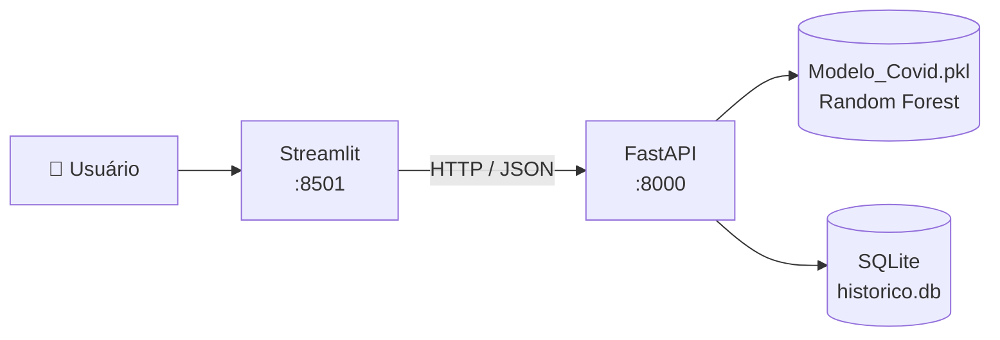

# 🏥 Predição de Risco de Óbito Hospitalar – COVID-19

Aplicação de Machine Learning que estima, a partir de dados de **ocupação de leitos hospitalares**, se um registro tende a ter **ao menos um óbito confirmado**. O projeto expõe o modelo por uma **API REST (FastAPI)** e oferece um **painel interativo (Streamlit)** que consome essa API, tudo empacotado com **Docker Compose**.

> ⚠️ **Projeto acadêmico.** O modelo foi treinado com dados agregados por registro hospitalar (e-SUS VEPI, 2022). Ele **não diagnostica pacientes** e **não deve ser usado para decisões clínicas**.

---

## 📌 Sumário

- [O que o projeto faz](#-o-que-o-projeto-faz)
- [Arquitetura](#-arquitetura)
- [Tecnologias](#-tecnologias)
- [Estrutura do repositório](#-estrutura-do-repositório)
- [Como executar](#-como-executar)
- [Usando a API](#-usando-a-api)
- [Treinamento do modelo](#-treinamento-do-modelo)
- [Limitações](#-limitações)
- [Próximos passos](#-próximos-passos)

---

## 🎯 O que o projeto faz

1. **Treina** um classificador (Random Forest) com dados de ocupação de leitos do e-SUS VEPI 2022, tratando o desbalanceamento de classes com **SMOTE**.
2. **Serve** o modelo por uma API com validação de dados, documentação automática (Swagger) e histórico de simulações em banco SQLite.
3. **Exibe** um painel onde o usuário informa a ocupação do hospital (ou escolhe um cenário pronto) e recebe a probabilidade de risco, recomendações operacionais e o histórico de simulações.

**Alvo do modelo:** `1` se o registro tem pelo menos um óbito confirmado (`saidaConfirmadaObitos > 0`), `0` caso contrário.

**Variáveis de entrada (informadas pelo usuário):**

| Campo | Descrição |
|---|---|
| `ocupacaoCovidUti` | Leitos de UTI ocupados por COVID |
| `ocupacaoCovidCli` | Leitos clínicos ocupados por COVID |
| `ocupacaoHospitalarUti` | Leitos de UTI ocupados (geral) |
| `ocupacaoHospitalarCli` | Leitos clínicos ocupados (geral) |
| `saidaConfirmadaAltas` | Altas hospitalares confirmadas |

**Atributos derivados (calculados pela API, idênticos ao treino):**

| Atributo | Fórmula |
|---|---|
| `totalOcupacao` | soma das quatro ocupações |
| `proporcaoCovidUti` | `ocupacaoCovidUti / (totalOcupacao + 1e-5)` |
| `razaoAltasOcupacao` | `saidaConfirmadaAltas / (totalOcupacao + 1e-5)` |

---

## 🧩 Arquitetura

Arquitetura desacoplada: apenas a API conhece o modelo e o banco de dados. O front é um cliente HTTP.



- O **Streamlit** nunca carrega o `.pkl` nem acessa o banco; ele só chama `POST /predict` e `GET /historico`.
- O **FastAPI** valida a entrada, calcula os atributos derivados, executa o modelo e grava cada simulação no SQLite.
- Qualquer outro cliente (outro front, script, outro sistema) pode consumir a mesma API.

---

## 🛠 Tecnologias

- **Python 3.12**
- **Machine Learning:** scikit-learn, imbalanced-learn (SMOTE), pandas, joblib
- **Backend:** FastAPI, Uvicorn, Pydantic, SQLAlchemy, SQLite
- **Frontend:** Streamlit, Plotly, Requests
- **Infraestrutura:** Docker e Docker Compose

---

## 📁 Estrutura do repositório

```
.
├── treinar.py              # Treino: limpeza, features, SMOTE, comparação de modelos e exportação
├── Modelo_Covid.pkl        # Modelo treinado (Random Forest) serializado com joblib
├── main.py                 # API FastAPI (/, /predict, /historico)
├── app.py                  # Painel Streamlit (consome a API via HTTP)
├── docker-compose.yml      # Orquestra os serviços api e front
├── Dockerfile.api          # Imagem da API
├── Dockerfile.front        # Imagem do painel
├── requirements.txt        # Dependências completas (execução local)
├── requirements-api.txt    # Dependências da imagem da API
├── requirements-front.txt  # Dependências da imagem do front
└── .dockerignore
```

> A base de dados (`esus-vepi.LeitoOcupacao_2022.csv`) e o banco `historico.db` **não** são versionados.

---

## 🚀 Como executar

### Opção 1 – Docker Compose (recomendada)

**Pré-requisitos:** [Docker](https://docs.docker.com/engine/install/) com o plugin Compose (`docker compose version` deve funcionar).

```bash
# 1. Clonar o repositório
git clone https://github.com/<seu-usuario>/<seu-repositorio>.git
cd <seu-repositorio>

# 2. Construir e subir os serviços
docker compose up --build
```

Acesse:

| Serviço | URL |
|---|---|
| Painel (Streamlit) | http://localhost:8501 |
| API – Swagger | http://localhost:8000/docs |

Comandos úteis:

```bash
docker compose up -d          # sobe em segundo plano
docker compose logs -f api    # acompanha os logs da API
docker compose down           # para e remove os contêineres (histórico é mantido)
docker compose down -v        # idem, mas apaga também o histórico (volume)
```

O histórico de simulações fica no volume Docker `historico_data` e persiste entre reinicializações.

> **Linux:** se aparecer `permission denied` ao usar o Docker, adicione seu usuário ao grupo com `sudo usermod -aG docker $USER` e abra uma nova sessão.

### Opção 2 – Execução local (sem Docker)

**Pré-requisitos:** Python 3.12 (ou compatível com a versão usada no treino).

```bash
# 1. Criar e ativar o ambiente virtual
python3 -m venv venv
source venv/bin/activate        # Windows: venv\Scripts\activate

# 2. Instalar dependências
pip install -r requirements.txt

# 3. Terminal 1 – subir a API
uvicorn main:app --reload --port 8000

# 4. Terminal 2 – subir o painel
streamlit run app.py
```

O painel usa `http://localhost:8000` por padrão. Para apontar para outra API, defina a variável de ambiente `API_URL`:

```bash
API_URL=http://meu-servidor:8000 streamlit run app.py
```

### Variáveis de ambiente

| Variável | Onde | Padrão | Função |
|---|---|---|---|
| `API_URL` | front | `http://localhost:8000` | Endereço da API usado pelo Streamlit |
| `API_PUBLIC_URL` | front | igual a `API_URL` | Endereço da API visto pelo navegador (link do Swagger) |
| `DATABASE_URL` | api | `sqlite:///./historico.db` | String de conexão do banco |

---

## 🔌 Usando a API

| Método | Rota | Descrição |
|---|---|---|
| `GET` | `/` | Health check (informa se o modelo foi carregado) |
| `POST` | `/predict` | Executa a predição e grava a simulação no banco |
| `GET` | `/historico?limit=50` | Lista as últimas simulações (mais recentes primeiro) |

A documentação interativa está em **`/docs`** (Swagger) e **`/redoc`**.

**Exemplo de requisição:**

```bash
curl -X POST http://localhost:8000/predict \
  -H "Content-Type: application/json" \
  -d '{
    "ocupacaoCovidUti": 45,
    "ocupacaoCovidCli": 30,
    "ocupacaoHospitalarUti": 20,
    "ocupacaoHospitalarCli": 10,
    "saidaConfirmadaAltas": 1
  }'
```

**Exemplo de resposta (`201 Created`):**

```json
{
  "id_simulacao": 1,
  "data_hora": "2026-10-13T19:40:12.123456",
  "risco_obito_detectado": 1,
  "probabilidade_obito_pct": 94.0,
  "total_ocupacao": 105.0,
  "proporcao_covid_uti_pct": 42.86,
  "mensagem": "ALERTA CRÍTICO: Risco elevado de óbito detectado. Recomenda-se acompanhamento intensivo."
}
```

Valores negativos ou campos ausentes retornam `422 Unprocessable Entity`. Se o modelo não estiver carregado, a API responde `503`.

---

## 🧪 Treinamento do modelo

O script `treinar.py` executa todo o pipeline:

1. Carrega o CSV `esus-vepi.LeitoOcupacao_2022.csv` (base pública do e-SUS VEPI – Ministério da Saúde).
2. Remove colunas irrelevantes e registros com todas as ocupações iguais a zero.
3. Cria os atributos derivados (`totalOcupacao`, `proporcaoCovidUti`, `razaoAltasOcupacao`).
4. Divide em treino/teste (80/20, estratificado, `random_state=42`).
5. Aplica **SMOTE apenas no conjunto de treino**.
6. Compara **Árvore de Decisão**, **Random Forest** e **Regressão Logística** (acurácia, precisão, recall e F1).
7. Exporta o **Random Forest** para `Modelo_Covid.pkl`.

Para retreinar:

```bash
# coloque o CSV na raiz do projeto
python treinar.py
docker compose up --build   # reconstrói a imagem da API com o novo modelo
```

> ⚠️ **Compatibilidade:** o `.pkl` deve ser carregado com a **mesma versão do scikit-learn** usada no treino. Fixe a versão em `requirements-api.txt` (ex.: `scikit-learn==X.Y.Z`, conforme `pip freeze | grep -i scikit`).

### Resultados

<!-- Preencha com a tabela impressa pelo treinar.py -->

| Modelo | Acurácia | Precisão | Recall | F1-Score |
|---|---|---|---|---|
| Árvore de Decisão | – | – | – | – |
| Random Forest | – | – | – | – |
| Regressão Logística | – | – | – | – |

---

## ⚠️ Limitações

- O modelo prevê óbito **por registro hospitalar agregado**, não risco individual de pacientes.
- A variável `saidaConfirmadaAltas` pertence à mesma família de colunas de saída do alvo (`saidaConfirmadaObitos`); isso pode inflar as métricas e deve ser considerado ao interpretar os resultados.
- Os dados cobrem apenas 2022; o comportamento da pandemia e do registro de dados mudou ao longo do tempo.
- A API não possui autenticação e o CORS está aberto (`*`), adequado apenas para desenvolvimento/demonstração.
- SQLite atende a demonstrações; para uso real com muitos acessos, prefira PostgreSQL.

---

## 🔭 Próximos passos

- [ ] Autenticação por chave de API e CORS restrito
- [ ] Testes automatizados (`pytest` + `TestClient`)
- [ ] Salvar o pré-processamento e a lista de features junto do modelo (`Pipeline`)
- [ ] Adicionar matriz de confusão e AUC-ROC à avaliação
- [ ] Migração para PostgreSQL e versionamento da API (`/v1`)
- [ ] CI/CD com GitHub Actions

---

## 👤 Autor

**<Seu Nome>** –

## 📄 Licença
